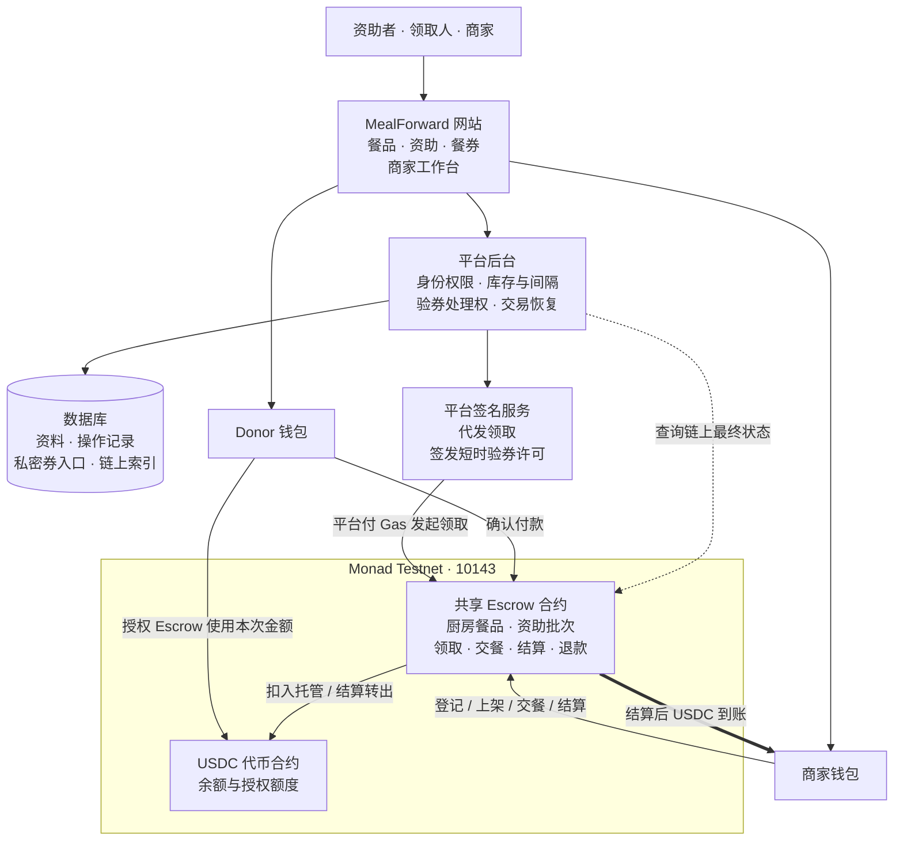
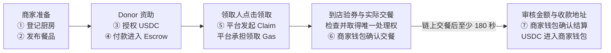
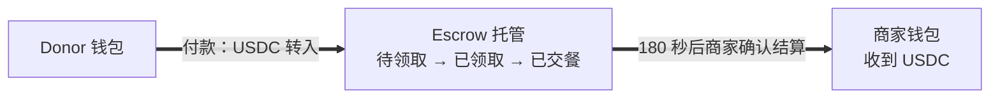
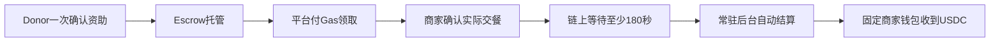

# 留膳 · MealForward 演进记录

把产品如何运转、已经改变什么、下一步要做什么，放在同一份记录里。

文档更新：**2026-11-05（北京时间）**。V3 已接通，真实钱包证据仍为此前 V2 闭环；本页不是实时监控。

## 01 · 当前版本

部署方式调整：按用户选择，复用 Render 免费 Web，在同一服务处理页面与结算任务。休眠期间自动结算暂停，唤醒后恢复；不新增每月 7 美元 Worker。

2026-11-05：V3 新合约 0x8718838C4B21519AEA83733DD9dC559B4cef7cae 已由用户部署、独立核验并登记；免费 Web 已接通 V3，后台心跳及新旧目录隔离通过；真实钱包资助、领取、交餐、自动到账仍待验收。

- **已上线**：Product V3 接入同一免费测试站；V2 历史订单保留，V3 交餐后的结算由平台处理。
- **已验证**：一次公网真实钱包主流程。资助 3 USDC / 3 份，其中 **1 份完成结算，商家收到 1 USDC**；该次核验时剩余 2 份待领取。
- **待验收**：退款、过期、跨账户访问、拒签和断网恢复的完整公网矩阵。本地实现或测试通过，不等于真实钱包全部验收。
- **付款兼容性**：当前实际钱包尚未通过原子批处理准入，donor 仍使用提前说明的授权/付款两步；不能声称单次钱包确认已验收。
- **原前端接入已上线**：继承原 Site 首页、照片、厨房卡片、商家侧栏与弹窗，接入现有真实 API；仍使用同一网址。桌面/手机本地流程与独立审查通过，e4f7632 已在原免费服务上线；真实钱包 V3 闭环仍待验收。

[打开新版测试站](https://mealforward-product-v2-laodao.onrender.com/product-v2/index.html) · [查看已通过的版本 CI](https://github.com/3956ray/MealForward/actions/runs/41407192957)

## 02 · V2 已验收架构（历史基线）

网站负责交互，后台校验身份、资格和操作，数据库保存资料及链上索引。**USDC 由共享 Escrow 托管；商家、平台后台都不直接保管 donor 的餐款。**

授权调用的是 USDC 合约，**被授权使用额度的是共享 Escrow**。数据库只记录与索引，链上合约决定资金是否实际到账。

## 03 · V2 一份餐如何完成（历史基线）

以下为正常成功路径，起点是新厨房、新餐品；donor 没有已有足额授权。钱包登录是消息签名，**不属于链上交易**。

| 阶段 | 谁确认交易 | 链上笔数 | USDC 位置 |
| --- | --- | ---: | --- |
| 登记厨房、发布餐品 | 商家 | 2 | donor 钱包 |
| 授权 Escrow 使用额度 | donor | 1 | 仍在 donor 钱包 |
| 付款并建立资助批次 | donor | 1 | Escrow |
| 领取餐券 | 平台自动发送 | 1 | Escrow |
| 出示取餐码、检查、取得唯一处理权 | 无钱包交易 | 0 | Escrow |
| 实际交餐并确认 | 商家 | 1 | Escrow |
| 等待至少 180 秒、审核金额 | 无钱包交易 | 0 | Escrow |
| 结算到账 | 商家 | 1 | 商家钱包 |

**从零开始 7 笔；已有厨房、发布新餐品 6 笔；已有上架餐品，从资助开始 5 笔。**足额授权可再省 1 笔。登记与发布可供多份餐复用；一次资助多份共享授权与付款，不应把 7 笔都按每份重复计算。

首次 7 笔中，商家确认 4 笔、donor 确认 2 笔、平台代发 1 笔。登录签名另计，连接/切网络弹窗不算交易。当前交易 Gas 用 MON 支付；领取由平台承担，其余上述交易由发送者承担。

结算转账就在 `settle` 交易内完成，无额外提现交易。交餐确认不会立即付款。未决操作只查询原请求与原交易，不重复交餐或付款。

## 04 · 演进记录

### 2026-11-03 · 单次资助与自动结算｜本地候选，未上线

新增独立V3合约：保持180秒，允许平台触发但餐款只到固定商家。后台拆分常驻worker，领取与结算共用持久nonce调度；旧餐券留在旧合约，继续原有领取与手动结算。新增官方账户实现核验及原子approve+fund流程；未验证钱包继续明确两次确认。

隔离测试链已验证自动结算、第三方同笔多券及手动抢先恢复；真实MetaMask批处理、用户新合约部署、收费worker配置和公网自动到账仍待验收。**当前页面7/5交易指标仍描述已上线V2，不因本地源码改动而改成6/4。**

新版目标流程（尚未发布）：

### 2026-11-03 · 文档建立｜文档完成

建立可离线打开的演进记录，纳入架构、流程、资金路径和版本证据。后续变化按日期追加，当前说明随版本更新。本次是文档交付，不是新增应用部署。

### 2026-11-02 · 结算展示优化｜已上线

待结算与已结算分区，厨房显示名称；刷新发现他端已结算时关闭过期审核。部署代码 `75e207f`，客户端 152 项通过 / 1 项既有跳过，独立商家测试 20/20，CI 通过。公网资源与构建产物一致。

### 2026-11-02 · 真实钱包主流程｜一轮已验证

已核验授权、付款、平台领取、商家交餐、商家结算的 5 笔最终确认交易。资助 3 份，完成结算 1 份；实际交餐至结算 279 秒，满足 180 秒门槛。不能将此写成 3 份全结算或全部异常验收通过。

### 2026-11-02 · 独立 Product V2｜已上线

新合约、新数据库隔离范围与独立服务承接完整产品入口。领取 Gas 由平台承担，私密券须领取时的钱包登录。原钱包测试服务与旧记录保留。

### 历史阶段 · 从演示到真实接入｜保留设计依据

| 阶段 | 已有内容 | 边界 |
| --- | --- | --- |
| 原 Site v8 · `e412ae14` | 完整主要产品交互、历史与异常恢复 | 模拟身份与数据 |
| 后续完整前端 | 注册、餐品管理、资助、领取、验券与结算接口适配 | 不代表已全部真实上链 |
| 原钱包测试版 | 真实钱包单份串行闭环 | 未承接完整产品流程 |
| 当前 Product V2 | 继承产品流程并接入独立测试网环境 | 主流程一轮实测，异常矩阵待补 |

## 05 · 已定规则与下一步

| 已确认规则 | 当前含义 |
| --- | --- |
| 平台承担领取手续费 | 领取人登录后点击领取，无需确认领取交易 |
| 私密券绑定原钱包 | 保存链接不能替代原钱包登录 |
| 内测 2 小时，正式目标 72 小时 | 领取间隔按全平台钱包计算；正式配置尚不是当前测试网配置 |
| 下架只停止新资助 | 已资助餐食继续允许领取 |
| 非营业时间与今日休息 | 允许领取；使用须符合餐券原用餐时段，过期照常返池 |
| 价格、内容变更生成新版本 | 历史订单与餐券保留原承诺 |
| 永久停业 | 未交餐券立即失效、餐款退原资助者，并解除匹配领取间隔；已交餐仍可结算。完整公网退款验收待补 |

| 优化事项 | 状态与目标 |
| --- | --- |
| 授权 + 付款合并 | **本地候选已实现，未上线**。已加入账户实现核验、原子付款与恢复；实际MetaMask/10143仍待兼容验收 |
| 到期自动结算 | **本地候选已实现，未上线**。V3固定商家收款、180秒及常驻队列通过隔离链测试；公网仍由商家手动结算 |
| 体验目标 | donor 一次付款确认；领取人无交易签名；商家交餐一次确认后到期自动收款。保留 180 秒规则时，后两步仍是独立链上交易 |
| 长期未使用退款期限 | **待定**，未设为半年或一年 |
| 公网异常验收 | 补齐过期、退款、跨账户访问和中断恢复；保留原操作查询能力 |

## 06 · 证据与维护

- 当前说明对应上线代码：`75e207ff3651bee42beb00dde686383a8ac0e481`；网络 Monad Testnet `10143`。Escrow：`0x999Edd25dBB7716D63a5360350dbD892b82312bD`。
- 仓库：[3956ray/MealForward](https://github.com/3956ray/MealForward)，[开发 PR #48](https://github.com/3956ray/MealForward/pull/48)。快照证据：[HANDOFF.md](../../HANDOFF.md)；[交易及签名详细说明](../superpowers/2026-11-02-transaction-and-signature-flow.md)。
- 绘图复用：[Mermaid](https://github.com/mermaid-js/mermaid)，MIT，查询日 2026-11-03 为 **90,983 Stars**。构建固定 `11.12.0`，图已内嵌，不依赖运行时 CDN。[官方使用文档](https://mermaid.js.org/config/usage.html)。
- 付款合并依据：[MetaMask 原子批处理](https://docs.metamask.io/metamask-connect/evm/guides/send-transactions/batch-transactions/)。能力尚未在当前账户与网络完成验证，不应将目标写成已上线。

维护入口为本 Markdown；页首元数据控制 HTML 的日期、状态和顶部交易指标。更新顺序：确认事实 → 修改当前说明 → 按日期追加变更和证据 → 重新构建 HTML → 检查桌面与手机阅读。已上线、已验证、待开发、待定必须保留区别；不记录私钥、会话、原始签名或餐券秘密。

阅读时直接打开 `index.html`，不需要安装依赖。仅在维护并重新生成时构建：在仓库根目录执行 `npm ci --prefix docs/product-evolution --ignore-scripts`，再执行 `npm run build --prefix docs/product-evolution`。需要本机已安装 Google Chrome 与 Playwright；默认用隔离的无头 Chrome 渲染。可用 `PLAYWRIGHT_CHANNEL` 指定其他已安装通道；构建器优先使用项目安装的 Playwright，也支持 `PLAYWRIGHT_MODULE` 指定模块路径。
