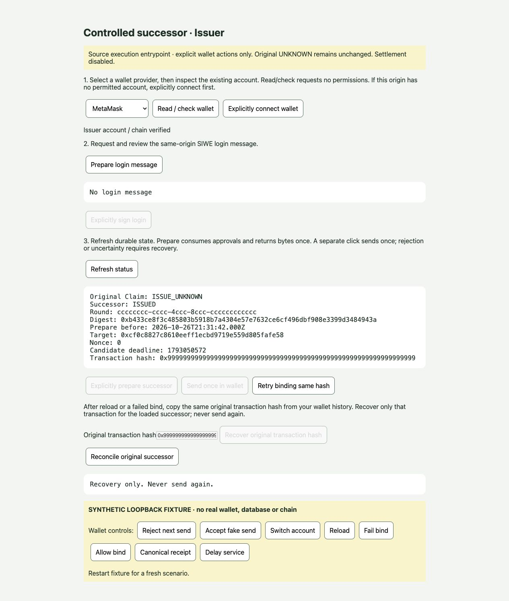

# Phase7 final source verification

Accepted executable source: `a527feff5e5ff89a5dd4c83964bd5713e8288829` on `codex/mealforward-t1f-phase6-release-review-20261026`, existing Draft PR47. Documentation-only follow-up commits do not change this tested source. Phase7 is not activated in the live environment; no real successor or transaction was created.

## Exact acceptance

[CI40404621279](https://github.com/3956ray/MealForward/actions/runs/40404621279) ran the exact accepted commit. All six jobs SUCCESS:

| Coverage | Result |
|---|---:|
| WalletV2 tests | 61 PASS |
| Non-PG application tests | 221 PASS |
| Legacy core PostgreSQL tests | 16 PASS |
| Legacy authenticated HTTP PostgreSQL tests | 13 PASS |
| Collector exact009-016 freshPG checks | 18 groups PASS |
| Execution exact009-017 freshPG checks | 16 groups PASS |
| Actual execution HTTP + exact009-017 freshPG lifecycle | 8 groups PASS |

Total:311 tests and42 additional PostgreSQL groups. Typecheck, syntax checks, deterministic WalletV2/crypto rebuild parity and unchanged-generated-file gates PASS. Every database job provisions a separate new PostgreSQL17.11 container; populated state is never shared between scripts.

All three task reviews and scoped fixes passed. Whole-phase review identified a missing original-hash recovery UI after reload and incomplete capability reporting; the single final fix wave addressed both, and scoped final review passed at a527fef. No material or minor findings remain parked. Earlier exact candidate CI runs40401826273 and40402906455 are historical evidence only; final acceptance uses40404621279.

## What the tests establish

- Six concurrent atomic consumes create one linked consumption/release/operation/audit. Wrong provenance, expiry, mismatched context or failed audit insertion causes no partial state.
- Exact callable-function identities and narrow role privileges are checked, including unexpected overloads. Collector reads survive consumption; collector writes stay closed. Original Claim/Consent/Fund/events/review/slot remain byte-equivalent.
- Signed historical anchor reconstruction is independent from fresh canonical observation. Nonce, code, authority, Unit/accounting and exact candidate simulation failures prevent reservation.
- Only the first committed prepare returns bytes. Lost response, HTTP timeout, restart, replay and expired approval cannot generate a second packet. Completed requests get a bounded response and late bytes are suppressed.
- Existing SIWE cookie identity, role, CSRF, origin, method, body, disabled mode and rate limits reject unauthorized requests. Execution uses its separately audited pool and defaults off.
- Bind verifies chain/hash/from/to/nonce/value/calldata before CAS. Pending/reverted/noncanonical or wrong events/operation/accounting cannot mark ISSUED. Canonical verification updates only the successor.
- Client actions remain explicit. Pre-reservation auth/read errors are retryable; once preparation is dispatched, recovery stays sticky. Payload is burned before wallet send and is never persisted. Reload/provider changes/refusal/timeouts cannot restore it.
- After a successful send and failed bind, a new controller can authenticate, load the same operation, reject an unrelated hash, recover the original hash from wallet history and reconcile, including after approval expiry. Bound hash replacement is denied and exactly one fake wallet send occurs.

## Main-owned browser evidence

CUA used the actual new page/controller, gateway and execution service with a labelled loopback-only synthetic auth/store/RPC/provider fixture. No real wallet, database or chain was used. Final a527fef flow:

1. Initial original-hash input and recovery action disabled.
2. Explicit wallet inspection, SIWE message preparation/signing, state refresh and successor prepare.
3. Fake send succeeded; intentional bind failure left recovery-only state.
4. Page reload, fresh explicit login and status restored the unbound same successor with no in-memory hash and no send ability.
5. Unrelated0x88...88 hash rejected without changing operation; original0x99...99 hash recovered as ISSUE_HASH_BOUND.
6. Canonical synthetic receipt reconciled to successorISSUED while originalClaim remainedISSUE_UNKNOWN. Prepare/send remained disabled.
7. Desktop and390px mobile viewport checked; clientWidth/scrollWidth375/375, no console errors/warnings. Viewport reset, temporary tab closed and owned fixture process stopped.

[Mobile screenshot](evidence/phase7-synthetic-mobile.png). Images are synthetic acceptance evidence, not a real Issue receipt. Prior source slices additionally exercised rejection/reload and same-memory bind retry. A stale synthetic snapshot was correctly rejected after its120-second freshness bound; independent scenarios restart the fixture with fresh synthetic state.

## Live read-only recheck

At2026-10-27 05:30 UTC+8, Supabase project `ketfrukrcuosrqynnsay` remainsPG17.11, rounds1/approvals2, successor release/operation/event0/0/0; execution schema/roles absent. The original six-table fingerprint before and after source pushes is `c0dd34d6df6ad76a43f79bc435cd0b4f`. This is MD5 of a JSONB object containing claims,consents,funds,events,reviews,slots, each array ordered by to_jsonb(row)::text. It includes review/hold tables and must not be compared with the older four-table01556b... fingerprint. Only the hash was returned, not private rows.

Collector remains live6f4710c / dep-dbfnnc59el5s73fumd50. Claim/SIWE remains livec8723c2 / dep-dbdto63rjlhs738br1sg. No migration, grant, new credential, environment change, deployment, real round, successor or transaction occurred in this source phase. The historical formal Owner/Donor2/2 acceptance remains valid evidence of that test; its expired round cannot authorize new execution.

## Reproduction and activation

From repository root: `node --test t1-intents/t1f-execution-ui.test.mjs t1-intents/t1f-execution-page.test.mjs t1-intents/t1f-execution-browser-fixture.test.mjs t1-intents/t1e-capabilities.test.mjs t1-intents/t1f-execution-service.test.mjs t1-intents/t1f-execution-http.test.mjs t1-intents/t1e-claim-http.test.mjs t1-intents/t1e-claim-setup.test.mjs` (final focused42/42 PASS).

Browser fixture: `FIXTURE_PORT=15449 node t1-intents/t1f-execution-browser-fixture.mjs`, then http://127.0.0.1:15449/. It binds loopback, requires its synthetic provider and excludes real-provider discovery. Restart for each independent scenario. The fixture is not in production imports/static allowlists.

Database scripts require a separately initialized empty PostgreSQL17.11 instance for EACH command at127.0.0.1:15439 with database/user postgres, no DATABASE_URL, and `MF_T1F_PHASE6_DISPOSABLE_ONLY=ack-fresh-phase6-pg17`. Run `t1f-execution-phase7.ci.mjs`; for the separate HTTP fixture also set `MF_T1F_EXECUTION_HTTP_DISPOSABLE_ONLY=ack-fresh-execution-http-pg17` and run `t1f-execution-http-phase7.ci.mjs`. The workflow is the exact executable setup reference. Never point these at a live database.

[Concrete activation package](t1f-phase7-activation-review.md) specifies final source/migration checksum, roles, exact Render targets, default-off deployment, authentication/public gates, human testing and preservation-based rollback. Real execution privileges are awaiting explicit activation confirmation under the Superpowers security-sensitive-action gate. Real MetaMask, hosted activation, RPC honesty/consensus, perpetual finality after later reorgs, settlement and onchain beneficiary-consent enforcement are not proven by this source acceptance.

## Implementation rulings

1. Proceed with source design/implementation under autonomous authorization, keeping live execution activation separate. If the scope choice is changed, the cost is reversible stage rework; no live funds were affected.
2. Trust protected immutable016 verification receipts, not fingerprints as independent cryptographic proof. Reversing this choice requires redesigning the execution proof protocol.
3. Include default-disabled integration into existing SIWE and a separate audited pool now, instead of postponing source mounting. Reversing this choice requires integration rework; no live permissions were changed.
